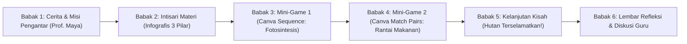
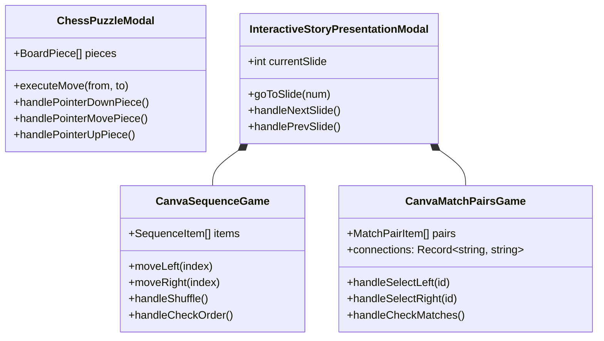
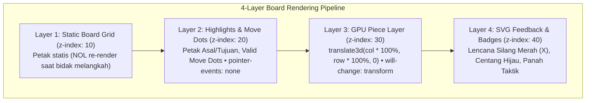
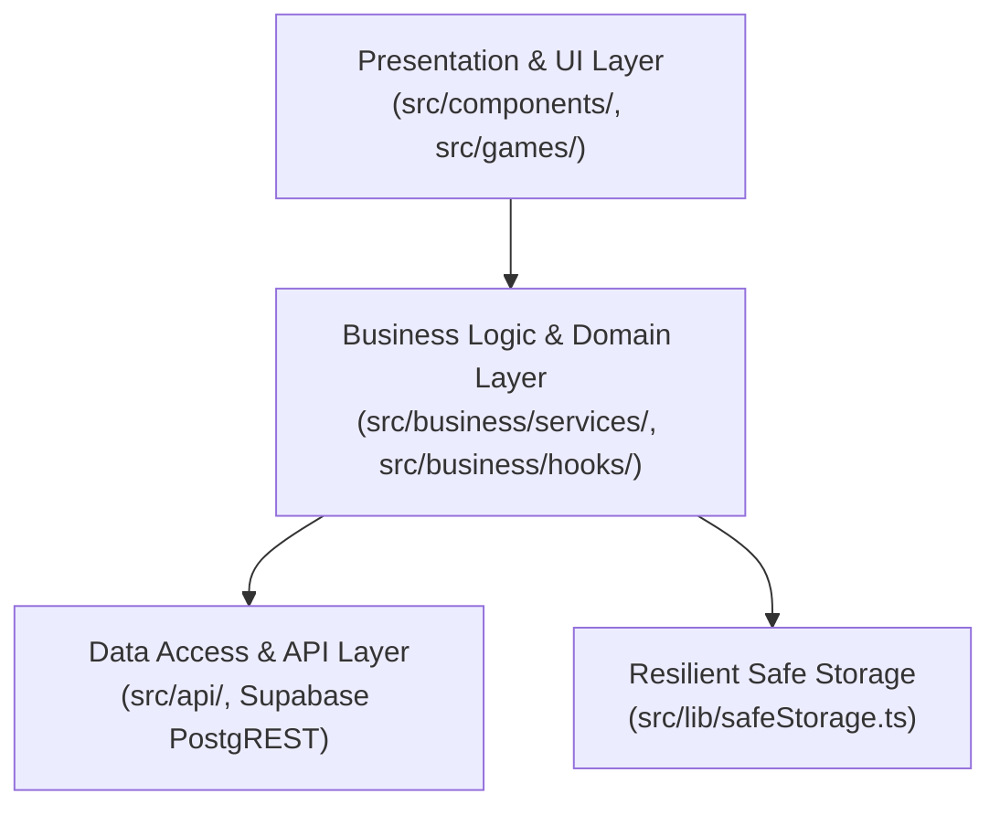
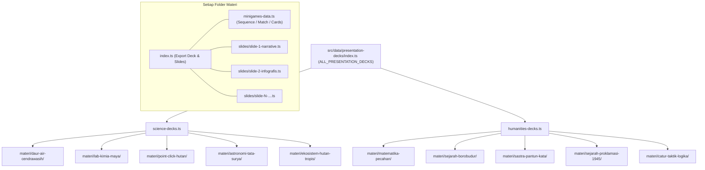

# Master Blueprint & Insights Platform: ueeee (`ueeee.my.id`)

> **DOKUMEN INDUK ARSITEKTUR & PANDUAN PENGEMBANGAN SISTEM**  
> Mengintegrasikan seluruh kebutuhan dan arahan pengguna: dari pengalaman kelas berbasis proyektor/smartboard, arsitektur presentasi bercerita (*Story-Driven Slide Presentation*), mini-game interaktif Canva Education (*Sequence & Match Pairs*), hingga engine papan 60 FPS GPU-accelerated ala Chess.com.

---

## 0. Paradigma Wajib: "Pola Pikir Game Android & Tablet, BUKAN Web!"

> [!IMPORTANT]
> **DOKTRIN UTAMA SELURUH PENGEMBANGAN:**
> Setiap materi dan fitur pada **ueeee** wajib diperlakukan layaknya **game edukasi native pada tablet Android / iPad / Nintendo Switch** (Toca Boca, Duolingo, Monument Valley, Genshin TCG, Chess.com):
> 1. **Canvas adalah Game Viewport:** Bebas scroll 100% (`overflow: hidden`), fit sempurna dalam 1 layar lanskap kelas/tablet.
> 2. **Chunky Tactile Touch Controls:** Tombol tebal minimal 48px–56px, border 2px solid, sudut membulat lebar `rounded-2xl`, shadow 3D nyata, dan animasi pegas sentuh `active:scale-95`.
> 3. **Fisika & Gesture Asli:** Drag-and-drop pointer 60 FPS terkunci di arena (mustahil melayang keluar canvas) dengan animasi merapat.
> 4. **Kartu TCG Mewah:** Desain kartu Trading Card Game bergaya koleksi dengan ilustrasi penuh/berbingkai emas, tanpa nomor kaku dan tanpa tombol panah geser.
> 5. **Direct Immersion:** Materi langsung beraksi di depan mata secara deterministik tanpa switcher desktop kerdil.

---

## 1. Visi Produk: "Presentasi Bercerita + Mini-Game Canva Pengganti Kuis Kering"

### A. Masalah Kritis di Ruang Kelas Saat Ini
- **Slide Presentasi Biasa (Statis):** Guru menampilkan slide PowerPoint/Canva yang penuh teks. Siswa hanya duduk pasif mendengarkan ceramah.
- **Kuis Pilihan Ganda Lepas (Kahoot/Quizizz):** Soal disajikan kering tanpa pengantar konteks narasi. Siswa berlomba menebak jawaban secepat mungkin tanpa memproses konsep secara mendalam.

### B. Solusi `ueeee`: *Story-Driven Interactive Slide Presentation*
Platform **ueeee** memadukan alur slide presentasi bercerita dengan mini-game interaktif di tengah alur:

#### 4 Pilar Pengalaman Pembelajaran:
1. **Narasi Sebelum Soal:** Setiap materi selalu diawali cerita latar dan karakter mentor kontekstual. Siswa tidak sekadar menjawab soal, melainkan menyelesaikan misi nyata di dunia cerita.
2. **Mini-Game Aktif Menggantikan Kuis:**
   - *Sequence Order:* Siswa mengurutkan kartu proses/siklus secara visual daripada memilih A/B/C/D.
   - *Match Pairs:* Siswa menghubungkan dua konsep menggunakan garis elastis SVG dinamis.
   - *3D Flashcards:* Kartu balik pemahaman konsep interaktif.
   - *Chess Tactics:* Papan catur taktis dengan umpan balik visual instan.
3. **Resolusi Konsekuensi Naratif:** Keberhasilan menyelesaikan mini-game berdampak langsung pada kelanjutan cerita (*positive feedback loop*).
4. **Catatan Guru & Pemantik Diskusi:** Di akhir slide disediakan pertanyaan pemantik (*discussion sparks*) agar guru dapat memperdalam diskusi kelas secara luring.

---

## 2. Taksonomi Mini-Game Canva Education

Berdasarkan fitur resmi *Canva Education Interactive Games* ("Quiz Yourself"), berikut adalah spesifikasi dari masing-masing tipe game:

### 1. `CanvaSequenceGame` (Put the Steps in Order)
- **Komponen:** [`src/components/canva-games/CanvaSequenceGame.tsx`](file:///run/media/nixon/6fde869e-c24a-48e3-80a4-6e3a943a14db/Project/ueeee/src/components/canva-games/CanvaSequenceGame.tsx)
- **Fungsi:** Mengurutkan kartu tahapan proses (misal: siklus fotosintesis, siklus air, metamorfosis, linimasa sejarah kemerdekaan).
- **Interaksi:**
  - Pointer Drag Engine 60 FPS (Chess.com style) dengan `setPointerCapture` dan boundary clamping strictly di dalam canvas.
  - Kartu lain bergeser dinamis (*merapat*) membuka slot preview gap ("Letakkan di Sini").
  - Desain kartu Trading Card Game (TCG) mewah tanpa nomor kaku dan tanpa tombol panah geser.
  - Dukungan Tap-to-Swap untuk kemudahan aksesibilitas kelas.
  - Tombol kontrol chunky 48px: `[ 🔀 Acak Ulang ]` dan `[ ✨ Periksa Urutan ]`.
  - Border kartu menyala hijau emas berkilau (posisi tepat) atau merah muda (posisi salah).

### 2. `CanvaMatchPairsGame` (Match the Pairs / Match A to B)
- **Komponen:** [`src/components/canva-games/CanvaMatchPairsGame.tsx`](file:///run/media/nixon/6fde869e-c24a-48e3-80a4-6e3a943a14db/Project/ueeee/src/components/canva-games/CanvaMatchPairsGame.tsx)
- **Fungsi:** Menjodohkan dua kolom konsep (Kolom A: Konsep $\leftrightarrow$ Kolom B: Definisi/Peran).
- **Interaksi:**
  - Garis elastis SVG putus-putus (*rubber-band connecting lines*) yang otomatis menghubungkan kartu kiri dan kanan secara dinamis.
  - Tombol `[ ↻ Reset Garis ]` dan `[ ✨ Periksa Pasangan ]`.

---

## 3. Arsitektur Engine Papan 60 FPS (Chess.com Reverse-Engineering)

Hasil riset teknis terhadap frontend Chess.com (`wc-chess-board`) dan Chessground diterapkan pada seluruh game berbasis papan (Ular Tangga, Teka-Teki Catur, Puzzle Grid):

### Formula Utama & Performa:
1. **Nol Layout Reflow:** Menggunakan `transform: translate3d(col * 100%, row * 100%, 0)` dengan `will-change: transform`. Transisi diproses langsung di GPU (Compositor Thread) pada 60 FPS – 120 FPS.
2. **Persentase Translation:** Menghilangkan kebutuhan resize listener JavaScript. Bidak otomatis 100% presisi di segala skala resolusi proyektor.
3. **Pointer Events Ganda:** Mendukung **Drag & Drop** dan **Click-to-Move** menggunakan `setPointerCapture`.
4. **Zero-Latency Web Audio API:** Efek suara langkah (`playChessMove`), makan (`playChessCapture`), error buzzer (`playChessError`), dan selebrasi (`playChessSuccess`) disintesis instan tanpa beban file MP3.

---

## 4. Desain Proyektor Kelas & TV Layar Sentuh (IFP Ergonomics)

> [!IMPORTANT]
> **TARGET AUDIENS UTAMA ADALAH GURU DI DEPAN KELAS** yang memproyeksikan materi ke proyektor 1080p/SVGA atau TV layar sentuh kelas (Smartboard/IFP).

1. **Full-Screen Stage Mode (`GameStageShell`):**
   - Wajib menggunakan `fixed inset-0 w-screen h-screen bg-[#f8fafc]`.
   - **DILARANG KERAS** menggunakan modal melayang di tengah layar dengan margin hitam gelap (`bg-black/60`) karena membuang ~40% display proyektor.
2. **Ukuran Target Sentuh:**
   - Seluruh tombol dan kartu interaktif memiliki tinggi minimal **48px – 56px**.
3. **Tipografi Kontras Tinggi:**
   - Teks soal berukuran minimal **20px – 28px** dengan warna `#0f172a` (Slate 900) agar terbaca jelas oleh siswa di barisan kursi belakang.
4. **Tombol Navigasi Wajib:**
   - Tombol `[ ← Kembali ke Beranda ]` di sudut kiri atas navbar panggung game.
   - Tombol native `[ ⛶ Layar Penuh ]` terintegrasi HTML5 Fullscreen API (tanpa label kata "(Proyektor)" yang berlebihan).
5. **HARD RULES Navigasi & UI Slide:**
   - **Larangan Tombol Next di Dalam Slide:** Navigasi antarslide dipusatkan mutlak pada Deck Footer Bar. Dilarang menaruh tombol Next/Mulai di dalam slide.
   - **Larangan Pill AI ("Berbicara..."):** Balon percakapan karakter dilarang memuat pill status berkedip seperti "Berbicara...".
   - **Zero-Scroll & Anti-Overflow:** Canvas slide WAJIB bebas scroll 100% (`overflow: hidden`). Seluruh infografis dan teks fit sempurna dalam layar.
   - **Tablet-First UI/UX:** Dilarang menggunakan switcher/tab segmented kerdil (`[ Mode A | Mode B ]`) atau tombol perbesar zoom kecil di slide. Gunakan target sentuh tebal minimal 44px–48px berstandar game tablet.
   - **Larangan Tombol Aksi Mini/Pill Kerdil:** Seluruh tombol aksi interaktif (selector tahapan, tombol mini-game, hotspot) wajib berukuran minimal 48px–56px (atau minimal 44px–48px pada grid padat) dengan dock aksi jelas, border tebal, font tebal, dan tactile shadow. Dilarang memakai pill tipis mini (`py-0.5`, `py-1`).
   - **Standar Chess.com Pointer Drag & Kartu TCG pada Sequence:** Dilarang menggunakan HTML5 native drag ghost, header angka kaku (`:: 1`), dan tombol panah footer (`[ ← ] Geser [ → ]`). Wajib menggunakan Pointer Events engine (`setPointerCapture`) dengan boundary clamping, animasi merapat slide kartu, slot preview gap (`Letakkan di Sini`), serta desain kartu bertaraf Trading Card Game (TCG).

---

## 5. Ringkasan File & Dokumentasi Terkait

| Dokumen / Komponen | Path Berkas | Deskripsi & Kegunaan |
|---|---|---|
| **Panduan Canva Games** | [`CANVA_INTERACTIVE_GAMES_SPEC.md`](file:///run/media/nixon/6fde869e-c24a-48e3-80a4-6e3a943a14db/Project/ueeee/CANVA_INTERACTIVE_GAMES_SPEC.md) | Spesifikasi lengkap game Sequence, Match Pairs, Flashcards, dan alur slide bercerita. |
| **Panduan Chess Engine** | [`CHESS_ENGINE_INSIGHTS.md`](file:///run/media/nixon/6fde869e-c24a-48e3-80a4-6e3a943a14db/Project/ueeee/CHESS_ENGINE_INSIGHTS.md) | Analisis arsitektur 4-layer, translate3d, Pointer Events, dan Web Audio API. |
| **Katalog Komponen** | [`COMPONENTS.md`](file:///run/media/nixon/6fde869e-c24a-48e3-80a4-6e3a943a14db/Project/ueeee/COMPONENTS.md) | Katalog seluruh komponen siap pakai (`GameStageShell`, `GameQuizModal`, dsb). |
| **Spesifikasi Game** | [`GAME_SPEC.md`](file:///run/media/nixon/6fde869e-c24a-48e3-80a4-6e3a943a14db/Project/ueeee/GAME_SPEC.md) | Blueprint game, batasan mutlak kelas, dan standar testing. |
| **Filosofi Produk** | [`PRODUCT.md`](file:///run/media/nixon/6fde869e-c24a-48e3-80a4-6e3a943a14db/Project/ueeee/PRODUCT.md) | Visi produk *Story-Driven Slide Presentation* dan zero-login access. |
| **Desain Visual** | [`DESIGN.md`](file:///run/media/nixon/6fde869e-c24a-48e3-80a4-6e3a943a14db/Project/ueeee/DESIGN.md) | Desain token Canva-style, palet warna, tipografi, dan ergonomi proyektor. |
| **Petunjuk Agent** | [`agent.md`](file:///run/media/nixon/6fde869e-c24a-48e3-80a4-6e3a943a14db/Project/ueeee/agent.md) | Banner arahan agent penerus agar tidak melakukan *reinvent the wheel*. |

---

## 6. Clean Architecture & Cloud Synchronization

Aplikasi mematuhi pembagian lapisan **Clean Architecture**:

1. **Presentation Layer (`src/components/`, `src/games/`):**
   - Mengonsumsi custom React domain hooks (`useGameProgress`, `useFavorites`, `useGameStats`).
   - Tidak pernah memanggil Supabase client atau `localStorage` secara langsung.
2. **Business Domain Layer (`src/business/`):**
   - Berisi business services: `progressService`, `sessionService`, `favoritesService`, `statsService`.
   - Mengelola input sanitization, boundaries clamping (e.g. `currentSlide`, `totalSlides`, `score`), offline-first optimistic caching, dan debouncing.
3. **Data Access Layer (`src/api/`):**
   - Pure typed data gateways (`progress.api.ts`, `favorites.api.ts`, `stats.api.ts`).

---

## 7. Security Hardening & Performance Optimizations

### A. Keamanan (Security Hardening)
1. **Content Security Policy (CSP):**
   - Didefinisikan ketat di `index.html`:
     `default-src 'self'; script-src 'self' 'unsafe-inline'; style-src 'self' 'unsafe-inline' https://fonts.googleapis.com; font-src 'self' https://fonts.gstatic.com data:; img-src 'self' data: blob: https://ueeee.my.id; connect-src 'self' https://takzivdrwlkpvniambhs.supabase.co wss://takzivdrwlkpvniambhs.supabase.co; object-src 'none'; base-uri 'self';`
2. **Keamanan Tambahan Browser:**
   - `X-Content-Type-Options: nosniff`
   - `Referrer-Policy: strict-origin-when-cross-origin`
   - `Permissions-Policy: camera=(), microphone=(), geolocation=(), payment=()` (mencegah akses hardware tak berizin).
3. **Resilient SafeStorage:**
   - Menggantikan `localStorage` mentah di seluruh domain logic.
   - Menyediakan automatic fallback in-memory Map saat `QuotaExceededError` atau browser private mode terjadi, menjamin aplikasi tidak akan pernah crash.
4. **Input Sanitization & Clamping:**
   - Semua input ID dibersihkan (`[a-zA-Z0-9_-]` dibatasi maksimal 64 karakter).
   - `currentSlide` dibatasi `[1, totalSlides]`, `totalSlides` dibatasi `[1, 50]`, dan skor `[0, 1.000.000]`.

### B. Performa Tinggi (High Performance & Code Splitting)
1. **Vite Code Splitting (`vite.config.ts`):**
   - Rollup `manualChunks` membagi bundle menjadi:
     - `vendor-react`: `react`, `react-dom`, `scheduler` (~251 kB)
     - `vendor-supabase`: `@supabase/supabase-js` (~222 kB)
     - `vendor-icons`: `lucide-react`
     - `vendor-confetti`: `canvas-confetti`
     - `game-decks`: data seluruh 10 story presentation deck (~80 kB)
     - `game-visuals`: SVG ilustrasi beresolusi tinggi (~63 kB)
   - Menghilangkan warning bundle > 500 kB (bundle awal turun drastis dari 901 kB menjadi modular).
2. **Dynamic Lazy Loading (`React.lazy` + `Suspense`):**
   - Seluruh modal game (`InteractiveStoryPresentationModal`, `ChessPuzzleModal`, `UlarTanggaModal`, `PointAndClickModal`, `PuzzleModal`, `PrologModal`, `SuperadminModal`) dimuat secara dinamis saat dipanggil pertama kali.
3. **Web Audio API Lifecycle Management (`src/lib/sound.ts`):**
   - Mendengarkan event `visibilitychange`. Saat tab diminimalkan atau berpindah tab (`document.hidden`), `AudioContext` otomatis di-suspend untuk menghemat CPU, RAM, dan baterai perangkat.
4. **Debounced Cloud Progress Sync (400ms):**
   - Menghindari *request spamming* ke Supabase saat siswa/guru membalik slide presentasi secara cepat.
5. **Component Memoization:**
   - `GameCard` dan `GameIllustration` dibungkus `React.memo` untuk mencegah re-render saat pencarian atau pergantian tab filter.

---

## 8. Superadmin Authentication & Authorization Architecture

1. **Google OAuth via Supabase Auth:**
   - Otentikasi Superadmin menggunakan Google OAuth yang terintegrasi dengan Supabase Auth (`apiSignInWithGoogle`, `apiSignOut`).
2. **Strict Email Whitelist Authorization:**
   - Akses Superadmin dikunci secara ketat dan eksklusif hanya untuk email yang ditentukan dalam environment variable: `VITE_SUPERADMIN_EMAIL=faizatia43@gmail.com`.
   - Email selain `faizatia43@gmail.com` **dilarang keras** mendapatkan hak akses Superadmin. Jika mencoba login dengan email lain, sesi otomatis diputus (*revoked & signed out*) dan dimunculkan pesan peringatan penolakan akses.
3. **Dashboard View Invariance (Prinsip Zero-Friction):**
   - Setelah login sebagai Superadmin, **tampilan dashboard tetap 100% sama persis**, menyajikan seluruh daftar materi pembelajaran secara lengkap tanpa tampilan berbeda atau dashboard terpisah.
   - Perbedaan utama hanya pada indikator/lencana status Superadmin aktif di header dan modal kontrol status.
   - Siswa & guru (guest) tetap dapat menggunakan seluruh fitur game secara bebas tanpa login (*Zero-Login Platform*).

---

## 9. Modular Materi & Slide File Organization Architecture (Spek Anti-Monolith)

Untuk mengantisipasi penambahan puluhan hingga ratusan materi kurikulum K-12 baru tanpa menyebabkan file membengkak (*monolith bloat*), seluruh story presentation deck telah ditransformasikan ke dalam struktur arsitektur modular:

### Aturan & Standar Teknis:
1. **1 Folder Per Materi:** Disimpan di `src/data/presentation-decks/materi/[materi-slug]/`.
2. **1 File Per Slide:** Disimpan di `src/data/presentation-decks/materi/[materi-slug]/slides/slide-[n]-[slug].ts`.
3. **Data Mini-Game Terisolasi:** Disimpan di `minigames-data.ts`. Slide yang menyematkan mini-game wajib mengimpor dan merujuk konstanta ini (`items: WATER_CYCLE_SEQUENCE`, `pairs: LAB_K3_PAIRS`) demi menjaga kesamaan referensi memori (*reference equality parity*).
4. **Export Terpusat Melalui Barrel:** File `science-decks.ts` dan `humanities-decks.ts` hanya melakukan re-export dari masing-masing folder materi dan mendaftarkan deck ke dalam `SCIENCE_PRESENTATION_DECKS` dan `HUMANITIES_PRESENTATION_DECKS`.
5. **Karakter & Ilustrasi Lingkungan:** Materi sains unggulan (seperti Daur Air Lembah Cendrawasih) menyematkan avatar karakter mentor (`KakGalihAvatar.tsx`) dengan gelembung dialog interaktif dan kanvas alam beranimasi (`EcosystemCanvasBackground.tsx`).
6. **Larangan Tombol Next Slide di Dalam Konten Slide:** Seluruh navigasi pergantian slide dipusatkan secara eksklusif pada **Footer Navigation Bar** panggung (`[ < Slide Sebelumnya ]`, slide indicator dots, `[ Slide Berikutnya > ]`). Dilarang keras membuat tombol navigasi pergantian slide di dalam tubuh konten slide (seperti di balon dialog mentor atau kartu materi) untuk menghindari duplikasi kontrol dan menjaga layout Canva-style tetap bersih.
7. **HARD RULE: Zero-Scroll & Anti-Overflow pada Canvas Slide:** Canvas panggung presentasi WAJIB 100% bebas scroll (`overflow-hidden`). DILARANG KERAS membiarkan ada elemen yang meluap (*overflow*) atau memicu munculnya scrollbar vertikal/horizontal di layar kelas. Seluruh elemen materi (infografis, diagram SVG, kartu tahapan proses, opsi jawaban) harus fit secara proporsional di dalam viewport proyektor (`flex-1 min-h-0`). Detail ulasan lanjutan ditampilkan via overlay terarah dengan tombol tutup mandiri.
8. **Ilustrasi SVG Terlokalisasi Per Materi (`illustration.tsx`):** Komponen visual infografis vektor SVG wajib berada di dalam masing-masing folder materi (`src/data/presentation-decks/materi/[materi-slug]/illustration.tsx`). DILARANG KERAS menumpuk ilustrasi multi-materi ke dalam satu berkas raksasa. Berkas `ScienceSvgIllustrations.tsx` dan `HumanitiesSvgIllustrations.tsx` hanya bertindak sebagai barrel facade re-export demi backward compatibility.
